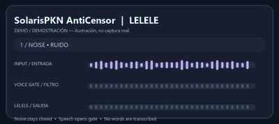
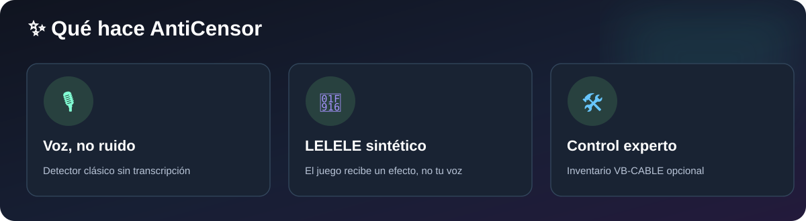
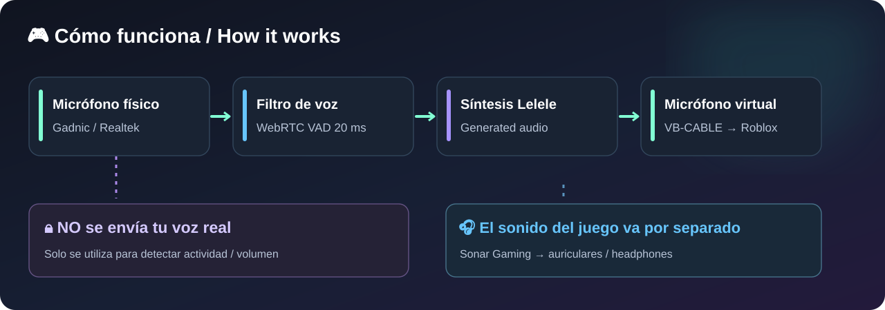

<strong>🎙️ ¡Tu voz controla Lelele, pero el juego no recibe tus palabras! 🦊</strong> 🇦🇷 Español · <a href="README.md">🇬🇧 English</a> · <a href="https://labs.solarispkn.com.ar/">💚 SolarisPKN-Labs</a>

# 🎤 SolarisPKN-AntiCensor v0.8.5
**Software desarrollado por [SolarisPKN-Labs](https://labs.solarispkn.com.ar/).**

🎮 Micrófono virtual experimental para gaming, roleplay y streaming. **Hablás al micrófono físico y AntiCensor genera Lelele sintético para el juego sin reenviar tu voz real.** El público de OBS puede seguir escuchando tu voz normal por una fuente separada. 💚

## 🚨 ¿Por qué nació AntiCensor? Una historia de streams, sustos y palabrotas

**Soy streamer y me encanta jugar experiencias de terror en Roblox.** Pero cuando un juego me pega un buen susto, a veces se me escapa alguna **puteada** en plena transmisión. Me cansé de que Roblox me sancionara y de quedarme sin acceso al **chat de voz**, justo en esos juegos de terror donde hablar y reaccionar es parte de la diversión.

De ahí nació **SolarisPKN-AntiCensor**: quería poder reaccionar con naturalidad para mi audiencia sin mandar esas palabrotas al chat del juego. El **Gadnic** detecta cuándo hablo, pero **Roblox recibe un «Lelele» generado artificialmente en vez de mis palabras**. Mientras tanto, **OBS puede seguir transmitiendo mi voz real** de forma independiente.

🎙️ **La idea no es transcribir, silenciar o censurar mis palabras una por una: es que el juego nunca reciba mi voz original a través de AntiCensor.** No garantiza evitar sanciones ni sustituye las normas de voz de Roblox.

🧪 Preview Windows 10/11 x64 · 🛠️ GPL-3.0-only · 🌍 Español / English · ✅ 66 pruebas automatizadas aprobadas en el entorno de desarrollo. La compatibilidad integral con todos los equipos y juegos sigue pendiente de validación real.

## 🎯 ¿Para qué sirve?
| Escenario | Resultado |
|---|---|
| 🎮 Roblox y juegos con entrada de micrófono seleccionable | El juego recibe Lelele sintético en lugar de las palabras reales |
| 🎭 Roleplay y humor | Un personaje habla con efectos al ritmo de tus intervenciones |
| 📺 OBS / streaming | Podés capturar tu voz real para el público y mandar Lelele al juego de manera independiente |
| 🔐 Privacidad contextual | AntiCensor no envía el PCM original de tu voz al dispositivo virtual; otras apps siguen pudiendo capturar el hardware si las configurás |
| 🧪 Pruebas de audio | Diagnóstico de dispositivos, niveles, calibración y detector de actividad vocal |

## ⚙️ ¿Cómo funciona?

1. 🎤 Seleccionás explícitamente tu **micrófono físico**.
2. 🧠 El **WebRTC VAD clásico** procesa ventanas temporales de 20 ms para detectar voz probable; no entiende palabras, no transcribe, no requiere IA generativa/LLM ni GPU.
3. 🎚️ La calibración transforma la intensidad de voz en volumen del sonido sintetizado.
4. 🤖 AntiCensor genera ondas nuevas de Lelele, sin copiar el audio original.
5. 🔌 El sintetizador envía audio a <code>CABLE Input</code> (reproducción de VB-CABLE); Roblox escucha <code>CABLE Output</code>, que puede mostrarse como <code>SolarisPKN-Mic Lelele</code> (grabación).

⚠️ **Importante:** VB-CABLE es compartido. Si otra app reproduce en CABLE Input, su audio puede llegar a CABLE Output. El Modo experto no deshabilita dispositivos Windows. VAD **no** es cancelación de eco: música, camiones y voces ajenas todavía pueden provocar falsos disparos.

## 🎮 Por qué lo hice y cómo lo uso
El objetivo es que **mi personaje de Roblox hable Lelele** mientras el stream puede escuchar mi voz real de forma comprensible.

| Equipo / programa | Ruta prevista | Función |
|---|---|---|
| 🎙️ Gadnic condensador con jack 3,5 mm | Entrada rosa Realtek → AntiCensor | Referencia de voz e intensidad |
| 🎧 Redragon Zeus X USB | Roblox/juegos → SteelSeries Sonar Gaming → USB | Escuchar juegos y música |
| 🤖 AntiCensor | Lelele sintético → VB-CABLE Input | Producir el efecto |
| 🎮 Roblox | SolarisPKN-Mic Lelele / CABLE Output | Recibir el efecto, no las palabras |
| 📺 OBS | Gadnic físico separado con sus filtros | Emitir voz real al público, si así se desea |

💡 **Consejo OBS:** si Lelele está en «Monitorizar y emitir» y no necesitás escucharlo en tus auriculares, elegí «Monitorización desactivada». Evita duplicar la reproducción. No confundir con silenciar la fuente del stream.

## ✨ Funciones
- 🗣️ WebRTC VAD **0–3**, predeterminado nivel 2; reduce clics aislados mediante votación y liberación gradual.
- 🎛️ Calibración por micrófono: silencio → susurro → voz normal → grito opcional (**5 s por etapa**).
- 🎙️ Selector WASAPI sin duplicaciones de MME/DirectSound/WDM-KS; no cambia silenciosamente de dispositivo si falta el anterior.
- 🌙 Interfaz oscura, medidor de intensidad, bandeja del sistema.
- 🧰 Modo experto opcional: inspección de endpoints VB-CABLE; no los deshabilita ni altera Windows.
- 💚 Pestaña **Acerca de** con portada oficial, autoría y web de SolarisPKN-Labs.
- 🇦🇷 🇬🇧 Interfaz y documentación bilingües.
- 🔄 Actualizaciones opcionales y verificadas por SHA-256, sin reemplazos mientras el programa está activo.

## 🚀 Instalación
Windows 10/11 x64. Consultá [GitHub Releases](https://github.com/SolarisPKN/SolarisPKN-LiveTools/releases) para obtener los instaladores publicados o compilá desde el código.

1. 📦 Instalá el paquete correspondiente a la versión.
2. 🔌 Cuando haga falta, instalá **VB-CABLE oficial** mediante la opción del asistente (puede requerir permisos y reinicio).
3. 🎤 Seleccioná el micrófono **físico**.
4. 🎚️ Calibrá los niveles en tu entorno de juego.
5. 🎮 Elegí **SolarisPKN-Mic Lelele / CABLE Output** como entrada del juego.
6. ✅ Comprobá que Lelele responde a la voz y que no se filtra el juego al micrófono.

## 🧑‍💻 Compilación y pruebas
~~~powershell
cd SolarisPKN-AntiCensor
powershell -ExecutionPolicy Bypass -File .\INSTALAR.ps1
python -m unittest discover -s tests -v
powershell -ExecutionPolicy Bypass -File .\packaging\BUILD_EXE.ps1
~~~
Se requieren PyInstaller e Inno Setup para el instalador completo. El script de gráficos regenera SVG y GIF originales; **no sustituye la portada entregada por el autor**.

## 📚 Documentación bilingüe
| 🇦🇷 Español | 🇬🇧 English |
|---|---|
| [📗 Guía de uso](docs/GUIA-DE-USO.es.md) | [📘 User guide](docs/USER-GUIDE.en.md) |
| [🧬 Arquitectura](docs/ARQUITECTURA.es.md) | [🧬 Architecture](docs/ARCHITECTURE.en.md) |
| [❓ FAQ](docs/FAQ.es.md) | [❓ FAQ](docs/FAQ.en.md) |
| [🔐 Privacidad y licencias](docs/PRIVACIDAD.es.md) | [🔐 Privacy and licensing](docs/PRIVACY.en.md) |
| [🗒️ Novedades](docs/RELEASE-NOTES.es.md) | [🗒️ Release notes](docs/RELEASE-NOTES.en.md) |

**Licencias:** el código AntiCensor es GPL-3.0-only ([LICENSE](LICENSE)). El cable virtual básico es software externo donationware propiedad de **VB-Audio Software / Vincent Burel**, [sitio oficial](https://vb-cable.com/) y [condiciones](https://vb-audio.com/Services/licensing.htm). No se incluyen cables adicionales A+B/C+D ni drivers modificados. Un micrófono virtual no garantiza anonimato ni exime de las normas de juegos/servicios.

---

💚 <strong>Software desarrollado por <a href="https://labs.solarispkn.com.ar/">SolarisPKN-Labs</a></strong> · 🎮 Gaming · 🎙️ Lelele
