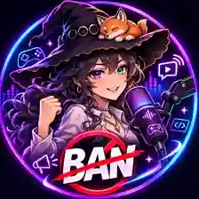
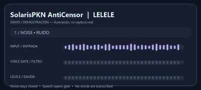
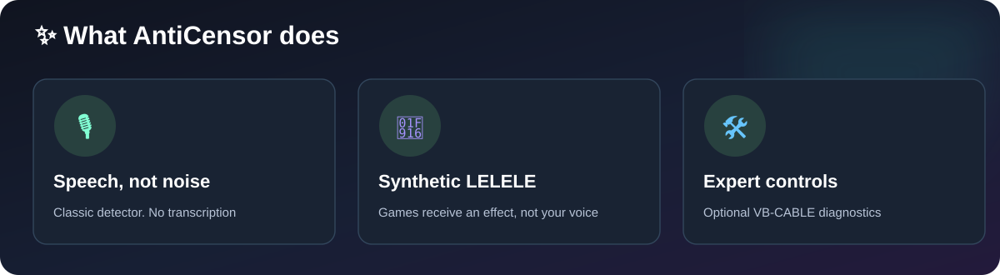
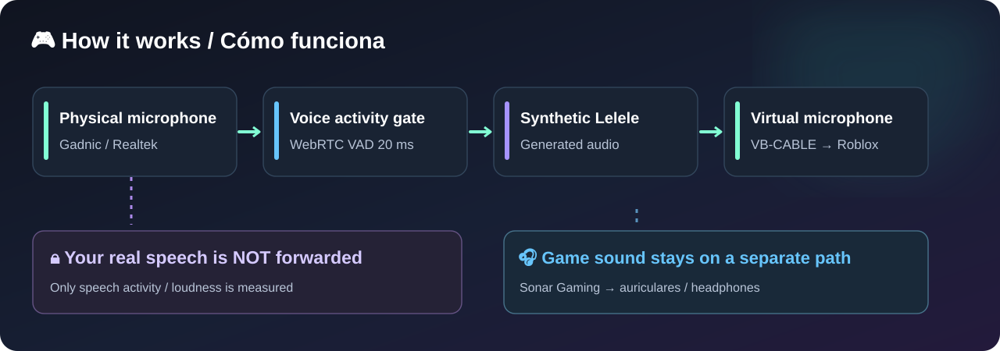

<strong>🎙️ Your voice drives Lelele. The game never receives your original words. 🦊</strong> 🇬🇧 English · <a href="README.es.md">🇦🇷 Español</a> · <a href="https://labs.solarispkn.com.ar/">💚 SolarisPKN-Labs</a>

# 🎤 SolarisPKN-AntiCensor v0.8.5
**Software developed by [SolarisPKN-Labs](https://labs.solarispkn.com.ar/).**

🎮 An experimental virtual microphone for gaming, streaming and roleplay. **Speak into your real mic and AntiCensor generates synthetic Lelele for your game instead of forwarding your real voice.** OBS may independently stream your natural speech to viewers. 💚

## 🚨 Why AntiCensor was born: horror streams, jump scares and accidental swearing

**I'm a streamer who loves Roblox horror games.** But when a jump scare catches me off guard, sometimes a **swear word slips out** live. I got tired of Roblox issuing sanctions and losing access to **voice chat**, especially in horror experiences where speaking and reacting is part of the fun.

That's why I built **SolarisPKN-AntiCensor**: I wanted to react naturally for my viewers without sending those spontaneous swear words into the game's voice chat. My **Gadnic microphone** detects when I speak, but **Roblox receives newly synthesized “Lelele” instead of my actual words**. Meanwhile, **OBS can keep broadcasting my real commentary** independently.

🎙️ **It doesn't transcribe, bleep or censor individual words: the game simply doesn't receive my original voice through AntiCensor.** It does not guarantee avoiding sanctions or replace Roblox's voice-chat rules.

🧪 Windows 10/11 x64 preview · 🛠️ GPL-3.0-only · 🌍 Spanish/English · ✅ 66 automated tests passed in development. Tests do not imply universal end-to-end compatibility.

## 🎯 What is it for?
| Scenario | Result |
|---|---|
| 🎮 Roblox and compatible games with a selectable microphone | Game receives synthetic Lelele instead of your actual words |
| 🎭 Character roleplay and comedy | The character makes a sound in sync with your speaking activity |
| 📺 OBS / streaming | Viewers can hear your natural voice from a separate source while your game hears Lelele |
| 🔐 Contextual privacy | AntiCensor does not send original mic PCM to VB-CABLE; separately configured software can still access hardware |
| 🧪 Audio testing | Inspect devices, calibrate loudness and test classical voice detection |

## ⚙️ How it works

1. 🎤 Explicitly select your **physical microphone**.
2. 🧠 **Classical WebRTC VAD** analyzes temporary 20-ms frames for probable speech; no word transcription, generative LLM or GPU required.
3. 🎚️ Calibration maps speech loudness to synthesizer amplitude.
4. 🤖 AntiCensor creates **new Lelele waveforms** instead of copying your real speech.
5. 🔌 AntiCensor plays to <code>CABLE Input</code> (VB-CABLE playback). Games capture from <code>CABLE Output</code>, optionally renamed <code>SolarisPKN-Mic Lelele</code> (recording).

⚠️ **Important:** VB-CABLE is shared. Other apps can inject audio through CABLE Input. Expert Mode is a UI visibility control, NOT a way to disable Windows endpoints. VAD is not acoustic echo cancellation: leaked music, traffic or game voices can still cause false triggers.

## 🎮 Why it was made: the creator's actual use
The goal is **a Roblox character speaking Lelele** while an OBS stream can retain understandable natural commentary.

| Device / app | Intended route | Purpose |
|---|---|---|
| 🎙️ Gadnic 3.5-mm condenser microphone | Realtek pink jack → AntiCensor | Detect voice/loudness |
| 🎧 Redragon Zeus X USB | Games → SteelSeries Sonar Gaming → USB | Hear games/music |
| 🤖 AntiCensor | Synthetic Lelele → VB-CABLE Input | Character voice effect |
| 🎮 Roblox | SolarisPKN-Mic Lelele / CABLE Output | Synthetic game input |
| 📺 OBS | Separate physical Gadnic with its own filters | Natural streamer voice, if enabled |

💡 **OBS tip:** if you don't need to hear Lelele in your headphones, turn off audio monitoring for that source instead of leaving “Monitor and Output” enabled. This avoids duplicated playback without muting the stream source.

## ✨ Features
- 🗣️ WebRTC VAD **0–3**, default level 2, voting/release hold to reject isolated clicks.
- 🎛️ Per-mic calibration: silence → whisper → normal speech → optional shout (**5 s per stage**).
- 🎙️ Clean WASAPI selection without MME/DirectSound/WDM-KS duplicates; no silent source replacement.
- 🌙 Dark interface, audio intensity meter and system tray.
- 🧰 Optional Expert Mode to inspect VB-CABLE endpoints without disabling them in Windows.
- 💚 About tab with the creator's official cover, author credit and SolarisPKN-Labs website.
- 🇦🇷 🇬🇧 Bilingual UI and documentation.
- 🔄 Opt-in updates verified using SHA-256 and deferred until AntiCensor closes.

## 🚀 Installation
Windows 10/11 x64. Find installers at [GitHub Releases](https://github.com/SolarisPKN/SolarisPKN-LiveTools/releases) when available, or build from source.

1. 📦 Install the matching AntiCensor setup package.
2. 🔌 Install **official VB-CABLE** when needed (setup may request admin privileges/reboot).
3. 🎤 Select your actual **physical microphone**.
4. 🎚️ Calibrate noise, whisper and speaking in your normal environment.
5. 🎮 Select **SolarisPKN-Mic Lelele / CABLE Output** as the game's input.
6. ✅ Check that voice activates Lelele but game playback stays on a separate route.

## 🧑‍💻 Build and test
~~~powershell
cd SolarisPKN-AntiCensor
powershell -ExecutionPolicy Bypass -File .\INSTALAR.ps1
python -m unittest discover -s tests -v
powershell -ExecutionPolicy Bypass -File .\packaging\BUILD_EXE.ps1
~~~
PyInstaller and Inno Setup are needed for a full setup build. The SVG/GIF generator does **not** replace the user's original cover art.

## 📚 Bilingual documentation
| 🇦🇷 Spanish | 🇬🇧 English |
|---|---|
| [📗 Guía](docs/GUIA-DE-USO.es.md) | [📘 Guide](docs/USER-GUIDE.en.md) |
| [🧬 Arquitectura](docs/ARQUITECTURA.es.md) | [🧬 Architecture](docs/ARCHITECTURE.en.md) |
| [❓ FAQ](docs/FAQ.es.md) | [❓ FAQ](docs/FAQ.en.md) |
| [🔐 Privacidad](docs/PRIVACIDAD.es.md) | [🔐 Privacy](docs/PRIVACY.en.md) |
| [🗒️ Notas](docs/RELEASE-NOTES.es.md) | [🗒️ Notes](docs/RELEASE-NOTES.en.md) |

**Licenses:** AntiCensor code GPL-3.0-only ([LICENSE](LICENSE)). Basic VB-CABLE is independent proprietary donationware by **VB-Audio Software / Vincent Burel**; [official website](https://vb-cable.com/) and [vendor licensing](https://vb-audio.com/Services/licensing.htm). Extra cables A+B/C+D and modified drivers aren't distributed. A virtual mic does not guarantee anonymity or exemption from game rules.

---

💚 <strong>Software developed by <a href="https://labs.solarispkn.com.ar/">SolarisPKN-Labs</a></strong> · 🎮 Gaming · 🎙️ Lelele
