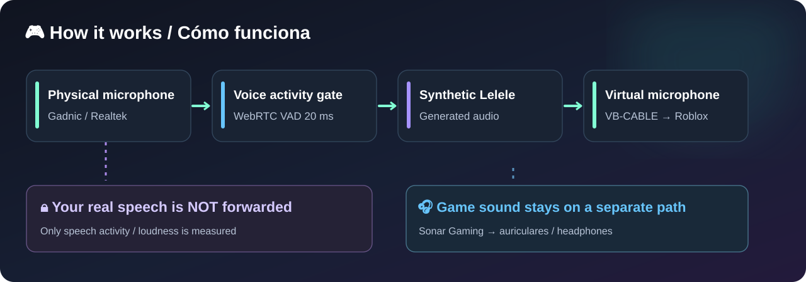

# 🧬 Technical architecture — AntiCensor v0.8.5
🇬🇧 English · [Español](ARQUITECTURA.es.md) · [Home](../README.md)

## 🔌 Signal path
Gadnic/Realtek (WASAPI capture) → RMS metering + classical WebRTC VAD → speech activity gate → newly generated Lelele signal → CABLE Input (render) → CABLE Output (capture) → game.

**Separation:** physical microphone PCM is **never copied** into CABLE Input. The synthesizer generates new samples. VAD returns probable activity, not a transcript.

## 🎚️ VAD and calibration
- WebRTC GMM VAD at 16 kHz in 20-ms frames; temporary sample-rate conversion from 44.1/48 kHz as needed.
- Two positive frames reduce isolated-click triggers; approximately 140 ms release hold.
- Configurable 0–3 strictness. RMS metering uses dBFS from the capture device; saved per-device calibration supports silence/whisper/normal/shout.
- If the enabled VAD dependency is missing, do not silently bypass protection.
- VAD can mistake leaked game voices for human speech. Acoustic echo cancellation is not implemented.

## 🧰 Device constraints
- CABLE Input = virtual playback; CABLE Output = virtual capture.
- Basic VB-CABLE is independent VB-Audio software, not an AntiCensor-written kernel driver.
- Expert Mode changes application UI visibility only, not Windows PnP, Secure Boot or driver signatures.
- OBS can separately capture the physical mic with its filters. AntiCensor's own capture does not inherit OBS filters.

## 🧪 Verification and privacy
61 automated development tests passed. This cannot guarantee Roblox selection or compatibility on every system. Public docs exclude user IP addresses, credentials, OBS profiles and local diagnostic reports.

[Licensing](PRIVACY.en.md) · [Guide](USER-GUIDE.en.md)