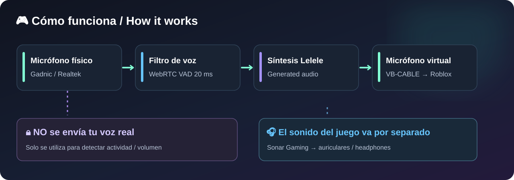

# 🧬 Arquitectura técnica — AntiCensor v0.8.5
🇦🇷 Español · [English](ARCHITECTURE.en.md) · [Inicio](../README.es.md)

## 🔌 Flujo de señal
Gadnic/Realtek (captura WASAPI) → medición RMS + WebRTC VAD clásico → compuerta de actividad → síntesis de señal Lelele → CABLE Input (render) → CABLE Output (capture) → juego.

**Separación esencial:** el PCM de entrada física **no** se copia a CABLE Input. El sintetizador crea ondas nuevas; el VAD solo devuelve una decisión aproximada de presencia de voz, no texto.

## 🎚️ Detector y calibración
- VAD WebRTC GMM a 16 kHz, frames de 20 ms, conversión temporal desde 44,1/48 kHz si procede.
- Dos ventanas positivas abren compuerta para limitar clics aislados; cola de aproximadamente 140 ms.
- Agresividad seleccionable 0–3. Intensidad RMS usa dBFS de audio capturado; la calibración maneja ruido/susurro/normal/grito por perfil.
- Si falta la dependencia activada, la aplicación no debe arrancar desprotegida silenciosamente.
- Un VAD puede confundir audio vocal filtrado desde juegos con voz propia; no hay AEC implementado.

## 🧰 Endpoints y limitaciones
- CABLE Input = reproducción virtual, CABLE Output = captura virtual.
- VB-CABLE básico pertenece a VB-Audio y es dependencia externa; no es un controlador nativo diseñado por AntiCensor.
- Modo experto afecta visualización en la app; no realiza cambios a Windows, PnP, firmas o Secure Boot.
- OBS puede capturar la entrada Gadnic física **antes o con filtros propios**. AntiCensor procesa su propia entrada y no hereda filtros de OBS.

## 🧪 Pruebas y privacidad
61 pruebas automatizadas registradas en el entorno de desarrollo. Se verifican en ellas parámetros y regresiones; **no** garantizan que Roblox siempre seleccione el dispositivo correcto. La documentación pública no incluye direcciones IP, credenciales, archivos de OBS del usuario ni diagnósticos de red.

[Licencias](PRIVACIDAD.es.md) · [Guía](GUIA-DE-USO.es.md)