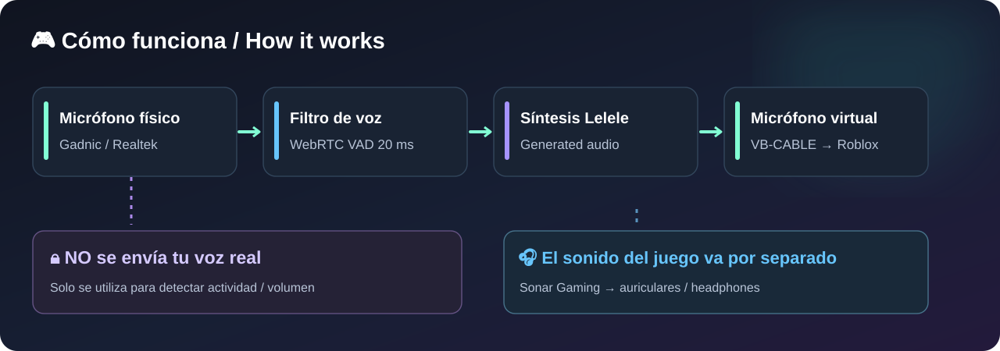

# 📗 Guía de uso — SolarisPKN-AntiCensor v0.8.5
🇦🇷 Español · [🇬🇧 English](USER-GUIDE.en.md) · [🏠 Inicio](../README.es.md)

**Software desarrollado por [SolarisPKN-Labs](https://labs.solarispkn.com.ar/).**

## 🎮 Objetivo
Hacer que un juego compatible reciba **Lelele artificial** generado cuando detectamos voz en un micrófono físico, mientras OBS puede transmitir una voz real por una fuente separada. **No** se reconocen palabras ni se envían samples del micrófono físico al cable desde AntiCensor.

## 🚀 Primer uso
1. Instalá AntiCensor en Windows x64. Si no existe **VB-CABLE básico oficial**, el asistente ofrece instalarlo y puede pedir UAC y reinicio.
2. En **Micrófono y sonido**, elegí tu micrófono físico. No selecciones SteelSeries Sonar Mix, Stereo Mix ni un cable virtual como entrada de referencia.
3. En **Calibración**, medí 5 segundos de silencio, luego 5 de susurro, 5 de voz normal y opcionalmente 5 de grito. Repetí una etapa si hubo ruido fuerte accidental.
4. En **Ajustes**, activá **Detector de voz clásico** (por defecto está activo). Estrictez **0–3**; **2** es un buen comienzo. Cuanto más alto, puede rechazar más ruido, pero también algunas voces débiles.
5. Presioná **ACTIVAR MICRÓFONO**. Seleccioná **SolarisPKN-Mic Lelele / CABLE Output** como micrófono del juego.
6. Probá sin hablar y después hablando: el juego debe escuchar el efecto sintético, **no** el contenido de tus palabras.
7. Si OBS usa otra fuente física Gadnic, podés mantener voz normal para el público. Verificá cada ruta por separado.

## 🎙️ Ejemplo real: Gadnic + Sonar + Roblox + OBS
| Fuente | Ruta | Utilidad |
|---|---|---|
| Micrófono condensador Gadnic 3,5 mm | Realtek Pink → AntiCensor | Detectar actividad/volumen de voz |
| Juego | Sonar Gaming → Redragon Zeus X USB | Escuchar el juego |
| AntiCensor | Generador → CABLE Input | Producir Lelele |
| Roblox | CABLE Output / SolarisPKN-Mic Lelele | Recibir solo Lelele |
| OBS | Fuente Gadnic real + filtros Speex/puerta | Transmitir voz comprensible |
| OBS opcional | Fuente Lelele | Comprobar el efecto |

**🛑 No confundas los nombres:** CABLE **Input** es el dispositivo de *reproducción*; CABLE **Output** es el de *grabación*. No deshabilites ninguno mientras el cable esté en uso.

## 🗣️ Filtrado de voz sin LLM
WebRTC VAD clásico procesa ventanas de 20 ms, exige varias señales compatibles con voz y aplica una liberación corta (~140 ms). No entiende ni transcribe palabras. Puede dispararse con diálogos del juego, música o camiones; no equivale a un supresor de ruido espectral/AEC. Revisá el enrutamiento si escuchás audio de juegos en el micrófono.

## 🛠️ Modo experto
Apagado oculta nombres y diagnóstico VB-CABLE **solo dentro de AntiCensor**. Encendido muestra endpoints del sistema para inspección. El control **no** desactiva ni oculta dispositivos en Windows y **no** impide que otros programas escriban en CABLE Input.

## 🔍 Diagnóstico de filtración en OBS
- En OBS, revisá **Propiedades avanzadas de audio**. Si Lelele está en «Monitorizar y emitir» hacia tus auriculares, podés poner **Monitorización desactivada** sin silenciar la fuente emitida.
- Confirmá que Sonar Gaming sale a los Redragon USB y el micrófono físico no escucha retorno virtual.
- No uses un umbral arbitrariamente alto para ocultar filtración real; tratá primero la ruta de audio.
- Una barra que se mueve en Lelele puede ser **síntesis activada por error** o audio de otra app escrito a CABLE Input. Probalo deteniendo AntiCensor unos segundos, con música sonando.
- Si la señal continúa con AntiCensor detenido, inspeccioná otras aplicaciones reproductoras de CABLE Input.

## 🔐 Privacidad
AntiCensor no genera transcripciones ni archivos de voz. Sí pueden capturar tu voz otras aplicaciones (por ejemplo OBS) que elegiste configurar con la entrada física. VB-CABLE es compartido. Leé [Privacidad y licencias](PRIVACIDAD.es.md).

[❓ FAQ](FAQ.es.md) · [🧬 Arquitectura](ARQUITECTURA.es.md)