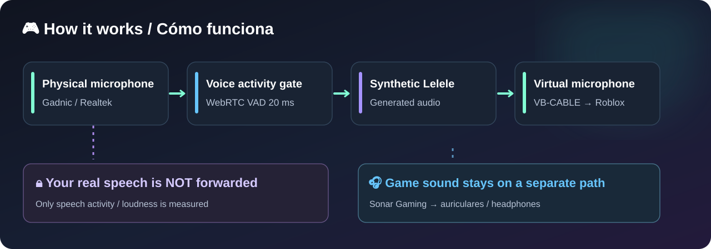

# 📘 User guide — SolarisPKN-AntiCensor v0.8.5
🇬🇧 English · [🇦🇷 Español](GUIA-DE-USO.es.md) · [🏠 Home](../README.md)

**Software developed by [SolarisPKN-Labs](https://labs.solarispkn.com.ar/).**

## 🎮 Why the project exists
**I'm a streamer who plays horror experiences on Roblox.** A jump scare sometimes makes me swear on air; I got tired of receiving **sanctions** and losing **voice-chat access** because of spontaneous reactions. I wanted to keep playing voice-driven horror experiences without broadcasting my actual words into Roblox chat. AntiCensor was born to generate **synthetic Lelele** when I speak, while OBS can still use my normal speaking voice for the audience. The effect does not guarantee exemption from moderation or Roblox rules.

## 🎮 Purpose
Make a compatible game receive **synthetic Lelele** when likely speech is detected on a physical microphone, while OBS can stream your natural voice via a separate source. AntiCensor neither transcribes words nor forwards physical mic samples to VB-CABLE.

## 🚀 First run
1. Install AntiCensor on Windows x64. The installer can offer the official **Basic VB-CABLE** package if absent; UAC and reboot may be required.
2. Under **Microphone & sound**, select your actual physical mic. Do not use a Sonar stream mix, Stereo Mix or virtual cable as your voice reference.
3. Under **Calibration**, record 5 seconds of silence, 5 seconds whispering, 5 seconds normal speech and an optional 5 seconds shouting. Repeat a stage if interrupted.
4. In **Settings**, enable **Classical voice detection** (default enabled). Strictness **0–3**, default **2**. Higher levels may reject more noise but also quiet speech.
5. Click **ACTIVATE MICROPHONE**. Choose **SolarisPKN-Mic Lelele / CABLE Output** in your game's microphone selector.
6. Test silence and speaking: the game should hear the synthetic effect, not your original words.
7. OBS may simultaneously use a separate Gadnic physical mic source for your audience; verify the routes independently.

## 🎙️ Creator's real setup
| Source | Route | Purpose |
|---|---|---|
| Gadnic 3.5-mm condenser mic | Realtek Pink → AntiCensor | Voice activity and loudness |
| Games | Sonar Gaming → Redragon Zeus X USB | Hear game playback |
| AntiCensor | Synthesizer → CABLE Input | Produce Lelele |
| Roblox | CABLE Output / SolarisPKN-Mic Lelele | Receive synthetic effect |
| OBS | Separate Gadnic mic source with filters | Send understandable natural commentary |
| OBS optional | Lelele source | Verify synthetic sound |

**🛑 Important naming:** CABLE **Input** is a *playback* endpoint; CABLE **Output** is a *recording* endpoint. Do not disable either when in use.

## 🗣️ Classical VAD, no LLM
WebRTC VAD analyzes temporary 20-ms frames, requires repeated voice-like activity and holds the output briefly (~140 ms). It does not decode or transcribe speech. Music, traffic or game dialogue may still trigger it: this is not spectral noise reduction nor echo cancellation.

## 🛠️ Expert Mode
Off: hides technical VB-CABLE names and controls **inside AntiCensor**. On: read-only endpoint inventory. It does **not** disable or hide any Windows device and cannot block other programs from playing into CABLE Input.

## 🔍 OBS audio bleed troubleshooting
- Check **Advanced Audio Properties**. For Lelele, disable monitoring if it currently echoes to your headphones; this does not have to mute the stream.
- Verify that Sonar Gaming routes to USB headphones and the physical mic is not receiving a virtual mix.
- Avoid raising the voice threshold to disguise actual routing issues.
- A bouncing Lelele meter can mean false-triggered **synthetic audio** or a **different app writing into CABLE Input**. Stop AntiCensor briefly while music plays: if Lelele continues, inspect other CABLE Input clients.

## 🔐 Privacy
AntiCensor writes no voice transcripts or speech recordings. Other applications explicitly configured to capture the real mic (e.g. OBS) can still record it. VB-CABLE is shared. See [Privacy & licensing](PRIVACY.en.md).

[❓ FAQ](FAQ.en.md) · [🧬 Architecture](ARCHITECTURE.en.md)